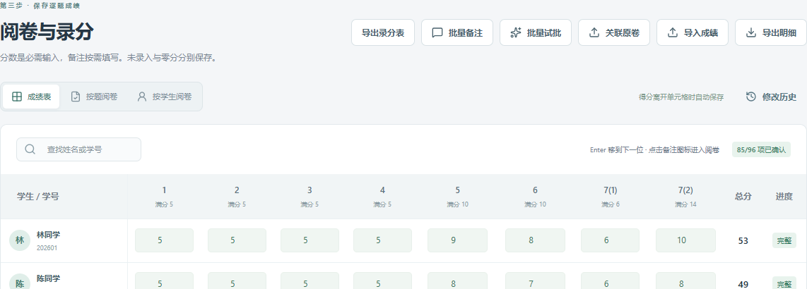
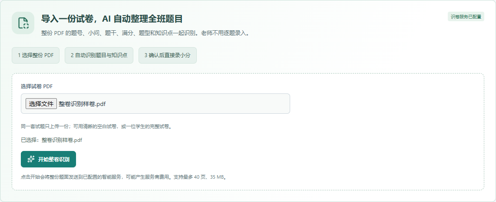
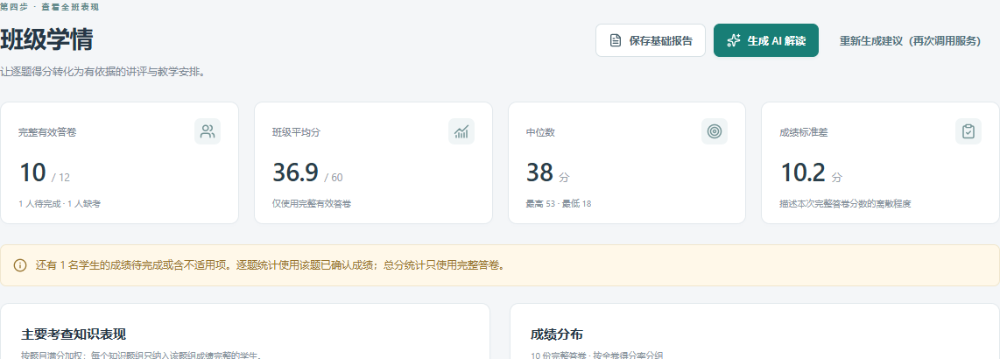

<div align="center">
  
  <h1>知衡 · 让阅卷成为有依据的教学反馈</h1>
  <p><strong>从原卷、评分标准到成绩与反馈，一个工作台完成。</strong></p>
  <p>A local workspace for teacher-reviewed grading and classroom feedback.</p>
  <p>
    <a href="https://github.com/Shhaaawwww/zhiheng-grading/actions/workflows/ci.yml"></a>
    <a href="LICENSE"></a>
    <a href="https://github.com/Shhaaawwww/zhiheng-grading/releases/tag/v0.3.2"></a>
    
  </p>
  <p><a href="#快速开始">快速开始</a> · <a href="#看看界面">看看界面</a> · <a href="教师操作指南-0.3.md">教师指南</a> · <a href="https://github.com/Shhaaawwww/zhiheng-grading/releases/tag/v0.3.2">下载源码</a></p>
</div>

知衡面向数学教师和课程助教，把题面、评分标准、学生原卷和逐题成绩放进同一个本机工作台。AI 辅助整理与预批，教师对照原卷确认；已经批好的考试，也可以直接导入成绩，查看个人与班级反馈。

**独立运行，无需 Codex。** 人工录分、基础统计与基础报告无需模型服务；AI 功能连接你选择的兼容视觉 API。当前发布为单教师、本机使用的源码试用版，以数学场景为主。



*上图及下方界面均使用虚构示例资料。*

## 为什么用知衡

| 你的工作 | 知衡提供的支持 |
|---|---|
| 每次考试重新整理题目和录分表 | 导入一份题面，核对题目、小问和满分后，生成整场考试共用的录分结构。 |
| 预批建议需要逐份核对 | 编辑并确认统一评分标准，查看作答原图和逐点评阅建议，逐项修订后确认成绩。 |
| 成绩散落在卷子和表格里 | 按题或按学生阅卷，导入、导出 Excel 小分和明细；空白、零分、草稿与缺考分别保存。 |
| 考试之后还要准备讲评 | 用已确认的成绩生成个人与班级反馈，保存基础报告，再安排辅导与复测。 |
| 一次任务中断后难以接着做 | 已完成的预批批次保存，失败后可以继续；题目、标准或原卷变化时提示重新核对相关结果。 |

你可以先用人工录分熟悉流程，再逐步加入 AI 识卷和预批。最终分数由教师确认，评分规则、题目结构和备注都可以编辑。

## 快速开始

安装 **Node.js 24**，然后任选一种方式获取源码：

- 下载 [0.3.2 源码包](https://github.com/Shhaaawwww/zhiheng-grading/releases/tag/v0.3.2)，解压后在项目目录打开终端。
- 使用 Git：

```text
git clone https://github.com/Shhaaawwww/zhiheng-grading.git
cd zhiheng-grading
```

依次运行：

```text
npm ci --ignore-scripts
npm run build
npm run server
```

打开 **[http://127.0.0.1:4318](http://127.0.0.1:4318)**，保持终端运行。资料库首次启动自动创建。此方式运行本机网页版，不需要 Python，也无需安装 Electron 二进制。

**第一次使用：点击首页「体验示例考试」。** 用虚构班级练习录分、查看统计和保存基础报告，无需 API key，也无需上传真实材料。示例用于体验工作流，不代表模型的实际评分效果。

### 选一条适合你的路线

**已经有成绩：** 建立班级 → 新建考试并核对题目 → 下载录分模板或导入小分 → 查看个人与班级反馈 → 导出成绩与报告。

**希望 AI 协助预批：** 在设置中连接兼容图片输入的服务 → 导入题面 → 核对并确认评分标准，可提供参考答案 → 上传每位学生的完整答卷 → 对照原图逐点复核 → 确认成绩。

每位学生每次提交一份完整 PDF，或一张包含完整作答的图片；双面及多页照片请先合成 PDF，建议以学号命名。详细操作见 [教师指南](教师操作指南-0.3.md)。

## 看看界面

### 一份题面，整理整场考试

导入题面后，核对题号、小问、满分与主要知识点。录分结构随考试生成，教师可以继续调整。



### 从已确认的成绩出发，准备下一次教学

查看有效人数、成绩分布和题组表现，保存个人与班级报告；需要进一步建议时再调用 AI 服务。网页版报告通过打印窗口另存为 PDF，桌面版支持直接导出 PDF。



## 用之前了解这些

| 项目 | 当前支持范围 |
|---|---|
| 使用方式 | 单教师、本机使用；源码网页版在 Windows、Ubuntu 上执行持续集成，Windows 桌面版需自行构建和验收。 |
| 学科与题型 | 数学为主；题目、小问、满分和评分点可编辑。其他学科、算法与代码题尚未完成独立 API 盲评。 |
| 答卷匹配 | 按文件名匹配学号或姓名；每位学生使用完整文件。暂不自动读取卷头身份或按照片编号合卷。 |
| 表格导入 | Excel、CSV、TSV 的第一个工作表、第一行表头，支持常见中文和英文身份列。先检查模板与导入预览。 |
| 模型服务 | 支持图片输入、兼容 Chat Completions 的服务；模型能力与参数支持需用自己的匿名样卷验证。服务费用由用户承担。 |
| 阅卷质量 | 手写、小字、旋转和图形可能被误读；缺页及证据不足需要人工核对，AI 建议经教师确认后成为正式成绩。 |

更多说明与既有验证证据见 [能力与审核记录](docs/audit-open-source.md)。

### 数据与 API key

资料库保存在本机。人工录分、基础统计和基础报告无需模型调用；AI 功能会把必要页面或内容发送给你配置的服务，原卷上的手写身份可能包含在图片里。

网页版 API key 仅保存在运行进程的会话内存中，重启服务后需重新填写。桌面版在系统支持时使用 Electron `safeStorage` 加密保存密钥；完整 `.zhb` 备份不包含服务密钥，但包含学生与考试资料，需要妥善保存。

公开仓库和源码包不附真实学生、成绩、原卷、数据库、运行配置或接口日志。敏感漏洞请使用 [私密漏洞报告](https://github.com/Shhaaawwww/zhiheng-grading/security/advisories/new)，不要粘贴到公开 issue。详见 [安全说明](SECURITY.md)。

## 开发、验证与参与

React + TypeScript、Express、SQLite；Windows 桌面外壳使用 Electron。依赖锁文件随源码提供。

```text
npm ci --ignore-scripts
npm test
npm run build
python scripts/package-source.py
python scripts/check-release-secrets.py --source-only
```

完整测试另需 Python 3.9 以上，仅使用标准库；应用运行无需 Python。CI 使用隔离的虚构资料和本机模拟接口，不调用付费模型。源码包按白名单生成，并附逐文件清单与压缩包 SHA-256。

- [测试与发布](TESTING.md)：本机验证、浏览器回归及桌面构建。
- [贡献指南](CONTRIBUTING.md)：提交修复、功能和可复现的问题。
- [更新记录](CHANGELOG.md)：当前与历史版本的变更。

欢迎提交匿名样卷的识别问题、表格兼容问题，以及能减少教师操作步骤的建议。问题反馈请附版本、复现步骤和预期结果；截图使用虚构资料，勿上传学生信息或密钥。

采用 [MIT 许可证](LICENSE)。第三方依赖授权见 [THIRD_PARTY_NOTICES.md](THIRD_PARTY_NOTICES.md)；试卷与上传材料的权利不随项目许可证转移。
